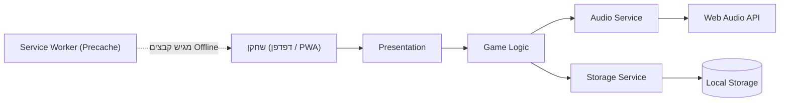
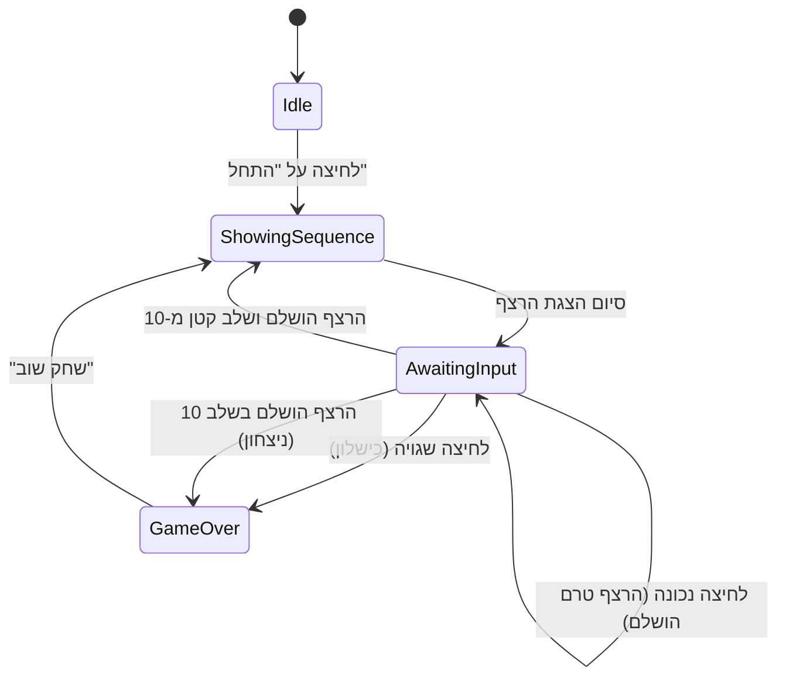
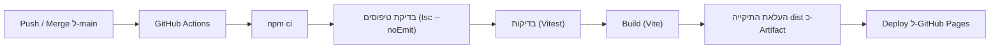

# ARCHITECTURE – משחק "סיימון" (Simon)

> מסמך זה מתרגם את דרישות ה-`PRD.md` לתכנון טכני. הוא מניח את כל ההחלטות והנחות ה-PRD (המסומנות שם כ"הנחה") כמחייבות.
> **שפת הממשק של המוצר:** עברית בלבד (RTL). כל טקסט שמוצג למשתמש מוגדר בעברית, ללא תלות בשפת מסמך זה.
> **מבנה כל סעיף:** קודם ההסבר העסקי, ואחריו הפירוט הטכני.

---

## 1. Technology Stack שנבחר

### א. עיקרון מנחה
ה-PRD מגדיר מוצר קטן: אתר מובייל בלבד, שני מסכים, ללא Backend וללא Database, עם PWA ועבודה Offline. מבחינה עסקית המשמעות היא שכל תוספת טכנולוגית מעבר ל-Frontend סטטי היא עלות תחזוקה בלי ערך למשתמש. לכן ה-Stack קטן, ללא Framework, ובעל אפס עלות הפעלה.

### ב. טבלת הרכיבים

| רכיב | טכנולוגיה | הסיבה העסקית | תפקיד טכני |
|---|---|---|---|
| שפת פיתוח | **TypeScript 6.x** (מצב `strict`) | מפחיתה באגים בפיתוח באמצעות AI ומשאירה את הקוד קריא ובטוח לתחזוקה | כתיבת כל קוד האפליקציה |
| ממשק משתמש | **Vanilla TypeScript + HTML + CSS** (ללא Framework) | שני מסכים ומצב קטן אינם מצדיקים Framework. פחות קוד, אפליקציה קלה יותר שנטענת מהר גם ברשת חלשה | בניית המסכים, הלוח והאנימציות באמצעות DOM ו-CSS ישירות |
| Build ו-Dev Server | **Vite 8.x** | הכלי הנפוץ והמתועד ביותר לאתרי Frontend. פיתוח מהיר ופריסה פשוטה | הרצה מקומית (`npm run dev`), בנייה לייצור (`npm run build`), בדיקת PWA מקומית (`npm run preview`) |
| PWA ו-Offline | **vite-plugin-pwa 1.3 ומעלה** (מבוסס Workbox, אסטרטגיית `generateSW`) | מאפשר התקנה על מסך הבית ומשחק ללא חיבור, בלי לכתוב Service Worker ידנית | יצירת Web App Manifest ו-Service Worker עם Precache לכל קבצי האפליקציה |
| צלילים | **Web Audio API** (יכולת מובנית בדפדפן) | ארבעה צלילים נוצרים בקוד: אין קבצי שמע לנהל, אין בעיות רישוי, והצליל מושמע מיד בלחיצה | יצירת טון לכל צבע באמצעות `OscillatorNode` |
| שמירת ניקוד | **Local Storage** (יכולת מובנית בדפדפן) | בדיוק מה שה-PRD דורש: שמירה על המכשיר, בלי שרת ובלי חשבונות | שמירת שיא אישי ו-5 משחקים אחרונים |
| בדיקות | **Vitest 4.1 ומעלה** | בדיקות אוטומטיות מונעות שבירה של חוקי המשחק בכל עדכון שנפרס אוטומטית | בדיקות יחידה ללוגיקת המשחק ולשכבת האחסון בלבד |
| סביבת ריצה וניהול חבילות | **Node.js 24 LTS** + **npm** | כלי ברירת מחדל מוכר וזמין, ללא תלות בכלי נוסף | הרצת Vite, הבדיקות וה-CI |
| ניהול קוד מקור | **Git + GitHub** | כנדרש: Repository ב-GitHub | Version Control |
| CI/CD ו-Hosting | **GitHub Actions + GitHub Pages** | פריסה אוטומטית אחרי כל שינוי, ללא עלות | Build, בדיקות ופרסום האתר לאינטרנט |

### ג. רכיבים שאינם נדרשים ולכן אינם נכללים
Backend, Database, Authentication, אחסון קבצים, APIs חיצוניים, שירותי AI, Vercel ו-Supabase. ה-PRD קובע במפורש שאין Backend ואין Database, ולכן אין צורך בהם ולא נוספו כדי להתאים את המוצר לאפשרות פריסה מסוימת.

### ד. הנימוקים להחלטות המרכזיות
- **ללא Framework.** React הוא הנפוץ ביותר בתעשייה (כ-84% שימוש לפי סקר State of JS 2025), אך יתרונותיו (ניהול מצב מורכב, מערכת רכיבים גדולה) אינם נדרשים כאן. Vue ו-Svelte נבחנו ונפסלו מאותה סיבה. בחירה בהם הייתה מוסיפה תלות וכלי Build נוספים ללא תועלת למשתמש.
- **Vite 8.** יצא ב-12 במרץ 2026 והוא הגרסה היציבה והנוכחית. דורש Node.js 20.19 ומעלה או 22.12 ומעלה.
- **vite-plugin-pwa בגרסה 1.3 ומעלה בלבד.** גרסה 1.2 הצהירה על תאימות עד Vite 7, וגרסה 1.3 הוסיפה תמיכה רשמית ב-Vite 8.
- **TypeScript 6.x ולא 7.0.** גרסה 7.0 (המימוש המהיר ב-Go) יצאה ב-8 ביולי 2026, אך כלים שנדרשים להם ה-API של המהדר עדיין נשענים על גרסה 6. העדפה לגרסה בשלה. מעבר ל-7 אפשרי בעתיד.
- **צלילים שנוצרים בקוד ולא קובצי MP3.** מונע הוספת נכסים, מפשט את ה-Offline ומאפשר השמעה מיידית. (מסלול חלופי: קבצי שמע מפוענחים מראש, ובו Latency גבוה יותר וקבצים לנהל.)
- **GitHub Pages ולא Vercel או Netlify.** המוצר הוא Frontend בלבד, ולפי עקרונות הפרויקט זו ברירת המחדל לאתר מסוג זה. אין צורך ב-Serverless או במסד נתונים.
- **Node.js 24 LTS.** גרסת LTS שנתמכת עד אפריל 2028. אפשר לעבור ל-Node.js 26 לאחר שיקודם ל-LTS (אוקטובר 2026).

### ה. סיכונים, מגבלות והסתייגויות
| סיכון או מגבלה | משמעות עסקית | התמודדות |
|---|---|---|
| **מתג השקט באייפון משתיק את Web Audio** | חלק מהשחקנים באייפון לא ישמעו צלילים אם המכשיר במצב שקט | ה-PRD כבר מגדיר שהמשחק ממשיך עם משוב חזותי בלבד. אין צורך בטיפול נוסף |
| **Safari מוחק Local Storage אחרי 7 ימי שימוש בדפדפן ללא כניסה לאתר** | שחקן שמשחק רק דרך Safari (ללא התקנה) ועוזב לתקופה עלול לאבד שיא. אפליקציה שהותקנה במסך הבית אינה מושפעת | מקובל במסגרת ה-PRD. ההתקנה כ-PWA היא ההגנה הטבעית |
| **טעינה ראשונה דורשת חיבור לאינטרנט** | בלי טעינה ראשונה מוצלחת האפליקציה אינה זמינה Offline | תואם ל-PRD (סעיף 4ב) |
| **באייפון ההתקנה ידנית** (Share ← Add to Home Screen) | אין חלון התקנה אוטומטי | ה-PRD אינו כולל ממשק התקנה מותאם (Out of Scope) |
| **עדכון גרסה מופעל רק בפתיחה הבאה של האפליקציה** | משתמש עשוי להמשיך בגרסה ישנה עד שיסגור ויפתח מחדש | נבחר במכוון כדי שעדכון לא ירענן משחק באמצע (סעיף 2ט) |
| **התאמת גרסאות** | שילוב לא תואם (למשל גרסת הפלאגין הישנה עם Vite 8) שובר את ה-Build | נעילת גרסאות בקובץ `package-lock.json` והרצת `npm ci` ב-CI |
| **GitHub Pages אינו מאפשר הגדרת HTTP Headers** | אין כותרות אבטחה צד-שרת | הגנה חלקית באמצעות תג `meta` של CSP (סעיף 2ז) |
| **Repository ציבורי בתוכנית החינמית** | Repository פרטי דורש תוכנית GitHub בתשלום כדי לפרסם ב-Pages | החלטה עסקית של הבעלים. הקוד אינו מכיל סודות |
| **טיימרים בדפדפן שרץ ברקע** | הצגת רצף עלולה להתעכב אם האפליקציה עוברת לרקע באמצע | ה-PRD אינו מגדיר טיפול. אין טיפול מיוחד בגרסה זו |

---

## 2. ארכיטקטורת המערכת

### א. מבנה כללי
אפליקציית Single Page סטטית אחת שרצה כולה בדפדפן. אין שרת, ואין תקשורת רשת בזמן המשחק. הקבצים נטענים פעם אחת ונשמרים במכשיר באמצעות Service Worker.



### ב. שכבות ומודולים
העיקרון העסקי: חוקי המשחק מופרדים מהמסך, כך שאפשר לשנות עיצוב בלי לסכן את חוקי המשחק, ולבדוק את החוקים אוטומטית.

| שכבה | מודול | אחריות |
|---|---|---|
| Presentation | **App Shell** | טעינת האפליקציה והרכבת מסך הבית (המסך היחיד) |
| Presentation | **Home Screen** | לוח המשחק העגול, לחצן "התחל" במרכז, מחוון השלב הנוכחי, לוח הניקוד וחלון הסיכום (Overlay) |
| Presentation | **Scoreboard** (רכיב בתוך Home Screen) | הצגת השיא האישי ורשימת המשחקים האחרונים (או מצב ריק, או הודעת "אחסון לא זמין"), ועדכון מיד בסיום משחק |
| Game Logic | **Game Engine** | מכונת מצבים של המשחק, יצירת הרצף, בדיקת לחיצות וקביעת סיום. אינו מכיר DOM, צליל או אחסון |
| Game Logic | **Config** | קבועים: ארבעת הצבעים, 10 שלבים, זמני הצגה, תדרי הצלילים |
| Services | **Audio Service** | יצירת הצלילים והפעלת ה-AudioContext בלחיצה ראשונה של המשתמש |
| Services | **Storage Service** | קריאה, אימות וכתיבה של הניקוד ב-Local Storage |
| Platform | **PWA Layer** | Manifest ו-Service Worker (נוצרים ב-Build) ורישום ה-Service Worker |
| Shared | **Strings (עברית)** | כל הטקסטים שמוצגים למשתמש במקום אחד |

תקשורת בין השכבות: ה-Presentation קורא ל-Game Engine וצורך את אירועיו. ה-Game Engine מקבל את ה-Audio ואת ה-Storage כתלויות מוזרקות (כך שניתן להחליפן בבדיקות). אין תקשורת הפוכה.

### ג. מבנה ה-Frontend

**מסכים וניווט.** מסך אחד בלבד (מסך הבית), שבו מוצגים גם לוח המשחק וגם לוח הניקוד, וחלון סיכום שנפתח מעליו בסיום משחק. אין מסכים נוספים, אין אלמנט ניווט ואין Routing לפי כתובת. מבחינה עסקית זה תואם ל-PRD (Refresh מחזיר תמיד למסך הבית ומתחיל משחק חדש) ומונע בעיות קישורים עמוקים ב-GitHub Pages.

**RTL ועיצוב.**
- המסמך מוגדר `lang="he"` ו-`dir="rtl"`.
- לוח המשחק מוגדר `dir="ltr"` כדי שפריסת הצבעים תישאר קבועה (ירוק למעלה-שמאל, אדום למעלה-ימין, צהוב למטה-שמאל, כחול למטה-ימין).
- רקע כהה ותצוגת טקסט בהיר, פונט מערכת עברי קריא, בהתאם לכיוון העיצוב הקלאסי שאושר.
- CSS רגיל עם משתני צבע (CSS Custom Properties). ללא ספריית עיצוב.
- מצב רגיל ומצב מואר לכל רבע מוגדרים כשני משתני צבע.

**התאמה למובייל.**
- תג `viewport` עם `viewport-fit=cover`, וגובה לפי `100dvh`.
- אזורי לחיצה גדולים לאגודל.
- מניעת זום בלחיצה כפולה (`touch-action: manipulation`) ומניעת בחירת טקסט ותפריט לחיצה ארוכה על הכפתורים.
- קלט באמצעות אירועי `pointerdown` להשהיה נמוכה.

### ד. Data Model – אחסון מקומי

מבחינה עסקית: נשמרים רק שני דברים שה-PRD דורש: השיא האישי ו-5 המשחקים האחרונים. שום מידע אישי אינו נשמר, ולא נשמר מצב של משחק פעיל.

**ישויות:**

| ישות | שדות | הערות |
|---|---|---|
| `ColorId` | `green` / `red` / `yellow` / `blue` | ארבעת הצבעים |
| `GameResult` | `levelReached` (מספר שלם 1 עד 10), `won` (בוליאני) | `levelReached` הוא השלב שבו נגמר המשחק, ובניצחון הוא 10. `won` נדרש כדי להבדיל בין ניצחון לכישלון בשלב 10 |
| `StoredScores` | `version` (כרגע 1), `best` (0 עד 10), `recent` (עד 5 פריטי `GameResult`, מהחדש לישן) | `best` נשמר בנפרד כי `recent` מכיל 5 משחקים בלבד |

**מפתח ב-Local Storage:** מפתח אחד, `simon.scores.v1`, ערכו JSON של `StoredScores`.

**כללים:**
- כתיבה מתבצעת רק בסיום משחק שהושלם (כישלון או ניצחון). משחק שלא הסתיים אינו נרשם.
- שבירת שיא: `levelReached` גדול מהשיא הקודם. שיא שווה אינו שבירה. כשאין שיא קודם הוא נחשב 0.
- פריט חדש נוסף בראש הרשימה, ואם יש יותר מ-5 הישן ביותר נמחק.
- בקריאה מתבצע אימות מבנה וסוגים. נתונים פגומים או גרסה לא מוכרת מאופסים למצב ריק, ללא קריסה.
- אם Local Storage חסום או נכשל (למשל גלישה פרטית): המשחק ממשיך לעבוד כרגיל, הכתיבה נבלעת בשקט, ולוח הניקוד במסך הבית מציג הודעה בעברית שהניקוד אינו זמין.

### ה. ממשקים (APIs)
**אין APIs חיצוניים ואין שירותי רשת.** הממשקים הם חוזים פנימיים בין המודולים:

| חוזה | יכולות עיקריות |
|---|---|
| Game Engine | התחלת משחק, קבלת לחיצת צבע, ומצב נוכחי. מפיק אירועים: הצגת צבע ברצף, תור המשתמש, מעבר שלב, סיום משחק (כישלון או ניצחון) |
| Audio Service | אתחול והפעלת ההקשר בלחיצה ראשונה, ניגון צליל של צבע נתון |
| Storage Service | קריאת הניקוד, רישום תוצאת משחק (מחזיר האם נשבר שיא), וזמינות האחסון |

### ו. Data Flow – זרימת משחק

**מכונת מצבים של המשחק:**



**פירוט הזרימה:**
1. **התחלה:** לחיצה על "התחל" מפעילה את ה-AudioContext (דרישת הדפדפן: פעולת משתמש), מאפסת את הרצף ומתחילה בשלב 1.
2. **הצגת רצף:** ה-Engine מוסיף צבע אקראי אחד לרצף (בשלב 1 הרצף הוא צבע אחד), ומציג את כל הרצף מההתחלה. כל צבע מואר ומושמע בצליל שלו. בזמן ההצגה לחיצות מתעלמות (מצב `ShowingSequence`).
3. **קלט:** בתור המשתמש כל לחיצה מואירה את הצבע, משמיעה את הצליל ונבדקת מול המיקום המתאים ברצף. לחיצות מהירות נבדקות לפי סדר ההגעה.
4. **המשך:** השלמת הרצף ← שלב חדש (חזרה ל-2). השלמת שלב 10 ← ניצחון.
5. **סיום:** לחיצה שגויה אחת מסיימת מיד. ה-Engine מעביר את התוצאה ל-Storage Service, שמחזיר אם נשבר שיא. מוצג חלון סיכום עם השלב שהושג, הודעה שונה לכישלון ולניצחון, וציון שבירת שיא.
6. **"שחק שוב":** מתחיל משחק חדש. Refresh בכל מצב מחזיר למסך הבית ומתחיל מצב ריק.

**אקראיות.** הצבע הבא נבחר באקראיות מלאה (`Math.random`), ללא לוגיקה נוספת וללא AI, כנדרש ב-PRD.

**זמנים וצלילים (Config).** מהירות הצגה קבועה בכל השלבים. ערכי פתיחה שניתנים לכיוונון בלי שינוי בארכיטקטורה: הדלקת צבע של כ-500 אלפיות השנייה, מרווח של כ-200 אלפיות השנייה בין צבעים. לכל צבע תדר קבוע שונה, וערכי פתיחה מוצעים: כ-262 הרץ, 330 הרץ, 392 הרץ ו-523 הרץ (אקורד דו מז'ור), עם עלייה וירידה קצרות של עוצמת הצליל למניעת "נקישות".

### ז. אבטחה ופרטיות
- **אין איסוף נתונים:** אין חשבונות, אין עוגיות, אין Analytics ואין קריאות לשירותים חיצוניים. כל המידע נשאר במכשיר.
- **HTTPS:** GitHub Pages מגיש את האתר ב-HTTPS, תנאי נדרש להתקנת PWA ול-Service Worker.
- **CSP:** מומלץ להגדיר מדיניות מוגבלת (`default-src 'self'`) באמצעות תג `meta` ב-`index.html`, ולוודא בבדיקה שאינה שוברת את הרישום של ה-Service Worker.
- **תלויות:** מינימום חבילות, ללא סקריפטים ממקורות חיצוניים בזמן ריצה, וקובץ נעילה (`package-lock.json`) ב-Repository.
- **Authentication ו-Authorization:** אינם רלוונטיים למוצר.

### ח. PWA ועבודה Offline
מבחינה עסקית: שחקן מתקין פעם אחת ומשחק בכל מקום, גם בלי חיבור, והאפליקציה נפתחת במסך מלא עם אייקון משלה.

**Web App Manifest:**
- שם: "סיימון" (הנחה מה-PRD), שפה `he`, כיוון `rtl`.
- `display: standalone`, `orientation: portrait` (הנחת ה-PRD).
- צבעי ערכת נושא ורקע כהים בהתאם לעיצוב.
- `start_url` ו-`scope` לפי נתיב הבסיס של האתר (סעיף 3ב).
- אייקונים: 192 ו-512 פיקסלים, גרסת Maskable, ואייקון `apple-touch-icon` לאייפון. האייקון מבוסס על לוח המשחק הקלאסי ומסופק כנכס סטטי בתיקיית `public`.

**Service Worker:**
- אסטרטגיית `generateSW` עם Precache לכל קבצי הבנייה: HTML, JavaScript, CSS, אייקונים ו-Manifest. ברירת המחדל כוללת רק HTML, JS ו-CSS, ולכן נדרש להגדיר גם סוגי קבצים נוספים (למשל `png` ו-`svg`) בהגדרת `globPatterns`.
- אין קבצי שמע ואין בקשות רשת בזמן ריצה, ולכן אין צורך ב-Runtime Caching.
- הרישום מתבצע בייצור בלבד.

### ט. עדכוני גרסה
בהתאם להנחת ה-PRD (עדכון ברקע, ללא הודעה): גרסה חדשה מורדת ומוכנה ברקע, אך אינה מופעלת עד לפתיחה הבאה של האפליקציה (ה-Service Worker החדש ממתין ואינו משתמש ב-`skipWaiting`). כך עדכון אינו מרענן משחק באמצע, וה-PRD אינו דורש חלון עדכון. כל פריסה חדשה יוצרת אוטומטית קבצי Precache חדשים.

---

## 3. תשתיות, Hosting ופריסה

### א. אחסון קוד מקור
Git Repository ב-GitHub, עם ענף ראשי `main`. אין סודות, אין משתני סביבה ואין מפתחות בפרויקט.

### ב. Hosting: GitHub Pages
מבחינה עסקית: אפס עלות, אפס תחזוקה שרתים, ופרסום אוטומטי אחרי כל שינוי שמאוחד ל-`main`.

- **מקור הפרסום:** בהגדרות ה-Repository (Settings ← Pages ← Source) בוחרים **GitHub Actions**.
- **כתובת:** `https://<שם-משתמש>.github.io/<שם-repo>/`.
- **נתיב בסיס (Base Path):** האתר רץ בתת-נתיב ולכן Vite מוגדר עם `base` של `/<שם-repo>/`. הערך מוזרק ב-Build ב-CI מתוך שם ה-Repository, ובהרצה מקומית נשאר `/`. אותו ערך משמש ל-`start_url` ול-`scope` של ה-Manifest ול-Service Worker.
- **מגבלות Pages לאתר זה:** אתר קטן בהרבה מהמגבלה (1 GB), רוחב פס רך של 100 GB בחודש, ומגבלת 10 בניות בשעה אינה חלה על פריסה דרך Actions מותאם.
- **דומיין מותאם:** לא נדרש ב-PRD.

### ג. תהליך Build ו-Deployment אוטומטי



**הגדרות ה-Workflow:**
- קובץ יחיד: `.github/workflows/deploy.yml`, מופעל בכל Push ל-`main` וגם ידנית (`workflow_dispatch`).
- הרשאות: `contents: read`, `pages: write`, `id-token: write`.
- `concurrency` על הקבוצה `pages` כך שרק פריסה אחת רצה בכל פעם.
- Node.js 24, התקנה באמצעות `npm ci` עם Cache של npm.
- שלבי הפריסה הרשמיים: `configure-pages`, `upload-pages-artifact` (על התיקייה `dist`), ו-`deploy-pages`. יש להשתמש בגרסאות הראשיות העדכניות כפי שמופיעות בתבנית הרשמית בתיעוד של Vite בעת המימוש.
- כישלון בבדיקת טיפוסים, בבדיקות או ב-Build עוצר את הפריסה, והאתר החי נשאר בגרסה הקודמת.

### ד. סביבות
סביבה אחת בלבד: **Production** (האתר ב-GitHub Pages). אין סביבת Development בענן, כי אין Backend ואין Database, ולכן ההנחיות לשני פרויקטים ב-Supabase ול-Database Migrations אינן רלוונטיות כאן.

הרצה והבדיקה במחשב:
- `npm run dev`: פיתוח עם רענון אוטומטי. ה-Service Worker אינו פעיל כאן.
- `npm run build` ואחריו `npm run preview`: בדיקת האתר בדיוק כפי שיפורסם, כולל PWA והתקנה ו-Offline.
- `npm test`: הרצת הבדיקות.

### ה. תצורה ופרטי גישה
אין סודות ואין פרטי גישה. הערך היחיד שמשתנה בין סביבת פיתוח ל-CI הוא נתיב הבסיס, שמוזרק אוטומטית ב-Workflow.

### ו. עלויות
עלות הפעלה שוטפת: 0 (Repository ציבורי). Repository פרטי דורש תוכנית GitHub בתשלום.

---

## 4. מבנה ה-Repository (ברמת תיקיות)

```
/
├── .github/workflows/   # Workflow הפריסה
├── public/              # אייקוני ה-PWA וקבצים סטטיים
├── src/
│   ├── app/             # App Shell, הרכבת מסך הבית
│   ├── ui/              # Home Screen, Board, Scoreboard, Overlay
│   ├── game/            # Game Engine, יצירת רצף, Config
│   ├── services/        # Audio Service, Storage Service
│   ├── i18n/            # כל מחרוזות הממשק בעברית
│   └── styles/          # CSS
├── tests/               # בדיקות יחידה ל-game ול-storage
├── index.html
├── vite.config.ts
├── package.json
└── package-lock.json
```

---

## 5. אסטרטגיית בדיקות
- **בדיקות אוטומטיות (Vitest)** לשני רכיבים בלבד, כי הם ללא תלות בדפדפן: חוקי המשחק (הרצף גדל בצבע אחד, 10 שלבים, כישלון ראשון מסיים, ניצחון בשלב 10) ושכבת האחסון (שבירת שיא, 5 פריטים אחרונים, נתונים פגומים, אחסון לא זמין).
- **בדיקות ידניות במכשיר אמיתי** (לא ניתנות לאוטומציה): השמעת צלילים באייפון ובאנדרואיד (כולל מתג שקט), התקנה למסך הבית, פתיחה Offline לאחר טעינה ראשונה, ויישור RTL ופריסת הלוח.

---

## 6. מקורות

- Vite 8 ודרישות Node.js: https://vite.dev/blog/announcing-vite8
- פריסת Vite ל-GitHub Pages (Workflow רשמי): https://vite.dev/guide/static-deploy.html
- נתיב בסיס לפרויקט ב-GitHub Pages עם Vite: https://til.simonwillison.net/github-actions/vite-github-pages
- vite-plugin-pwa (מאגר ותיעוד): https://github.com/vite-pwa/vite-plugin-pwa
- vite-plugin-pwa 1.3.0, תמיכה ב-Vite 8: https://newreleases.io/project/npm/vite-plugin-pwa/release/1.3.0 ו-https://github.com/vite-pwa/vite-plugin-pwa/issues/923
- Vitest 4.1, תמיכה ב-Vite 8: https://main.vitest.dev/blog/vitest-4-1
- TypeScript 7.0 (יולי 2026): https://devblogs.microsoft.com/typescript/announcing-typescript-7-0/
- TypeScript 6.0: https://codersera.com/blog/typescript-6-0-whats-new-breaking-changes-2026/
- מגבלות GitHub Pages: https://docs.github.com/en/pages/getting-started-with-github-pages/github-pages-limits
- מדיניות הפעלת שמע אוטומטית ב-Web Audio: https://blog.openreplay.com/playing-sounds-web-audio-api/
- מגבלות שמע בדפדפני מובייל (כולל מתג השקט באייפון): https://www.abratabia.com/web-game-audio/mobile-audio-issues.php
- מגבלת 7 הימים של Safari על אחסון מקומי והפטור לאפליקציות במסך הבית: https://ionic.io/blog/is-apple-trying-to-kill-pwas ו-https://www.theregister.com/2020/03/26/apple_relax_were_not_totally/
- לוח הזמנים של Node.js: https://dev.to/mr_manushukla/one-nodejs-release-a-year-from-2027-what-the-node-27-lts-change-means-for-your-upgrade-cadence-2fo3
- נתוני אימוץ Frameworks (State of JS 2025): https://blog.codercops.com/blog/state-of-javascript-2025-survey-2026
