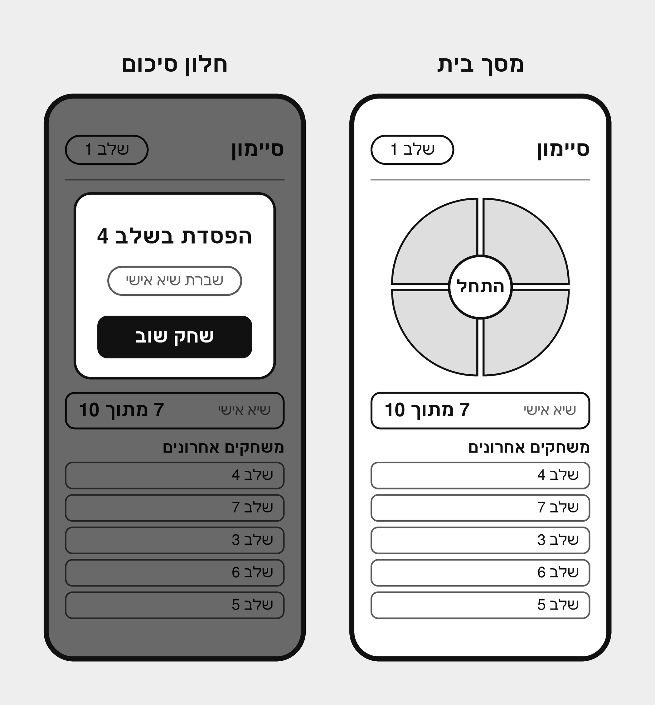
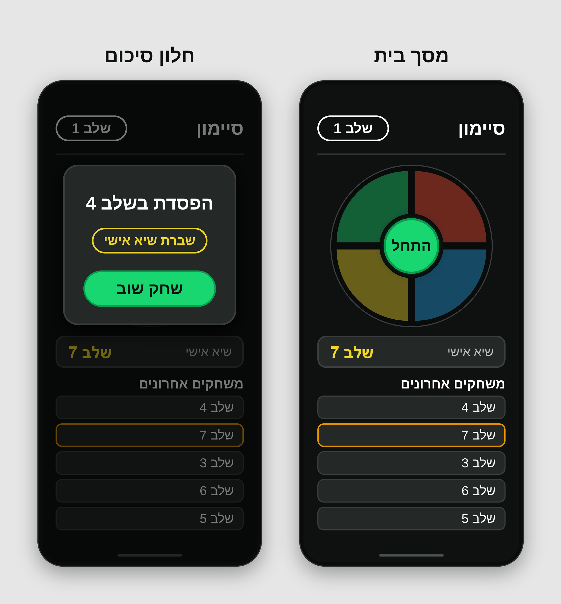
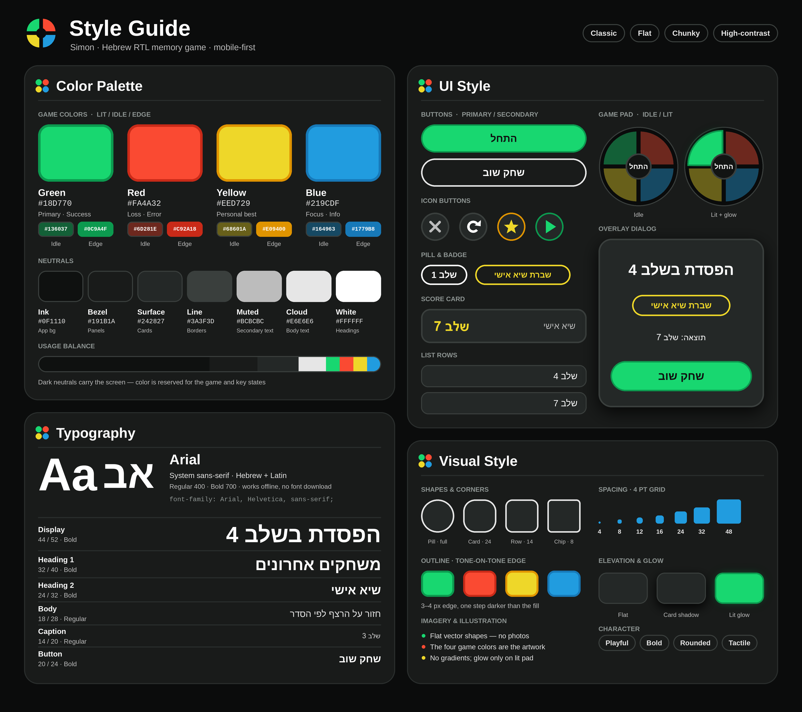

# DESIGN – משחק "סיימון" (Simon)

> **שפת הממשק:** עברית בלבד, RTL. כל טקסט המוצג למשתמש מצוטט במסמך זה בעברית, בדיוק כפי שהוא מופיע ב-Mockups.
> **מקורות:** `PRD.md` (דרישות), `wireframes.png` (מבנה), `style-guide.png` (שפה עיצובית), `mockups.png` (המראה הסופי).
> **סדר עדיפויות במקרה של פער:** מבנה ותוכן מה-Wireframes, שפה עיצובית מה-Style Guide, ערכים מדויקים של מסך מסוים מה-Mockups.
> **יחידות:** מידות ה-Mockups נתונות ביחידות עיצוב על מסך ייחוס ברוחב 404 ובגובה 894 (יחס 9:19.5). בפיתוח יש להתייחס אליהן כ-px של עיצוב ולהגמיש לפי רוחב המכשיר.
> **גודל לוח המשחק:** הלוח ממלא את רוב המסך: את רוחב המסך (פחות השוליים הצדדיים) או את הגובה שנשאר מתחת לכותרת, לפי הקטן מביניהם, ולעולם אינו קטן מגודל ה-Mockup (קוטר 304). כל המידות שבתוך הלוח (רבעים, מרווחים, כפתור "התחל") גדלות באותו יחס. בטלפון הלוח כמעט ברוחב המסך, ובמחשב הוא ממלא את גובה החלון.
> **מסכים נמוכים:** אם התוכן אינו נכנס בגובה המסך, הדף נגלל אנכית. לא מכווצים את הלוח מתחת לגודל ה-Mockup כדי שייכנס לגובה, ולא מסתירים שורות מרשימת המשחקים.

---

## 1. Screens – מסכי האפליקציה

### מבנה המסכים (Wireframes)



### המראה הסופי (Mockups)



האפליקציה בנויה ממסך אחד קבוע (**מסך בית**) וחלון **Overlay** אחד שנפתח מעליו בסיום משחק (**חלון סיכום**). אין מסך נוסף ואין סרגל ניווט.

---

### 1.1 מסך בית

**מטרת המסך:** זהו המסך היחיד שהשחקן רואה כשהוא פותח את האפליקציה, והוא משרת שלוש מטרות: להתחיל משחק בלחיצה אחת, לשחק בו, ולראות את ההתקדמות האישית (שיא ו-5 משחקים אחרונים) בלי לעבור למסך אחר. הצבת לוח הנקודות באותו מסך שומרת על הכניסה המיידית למשחק ועל הסיבה לחזור ולשפר תוצאה.

**מבנה ותוכן** (מלמעלה למטה, לפי ה-Wireframes וה-Mockups):

| אזור | תוכן | מידות ב-Mockup |
|---|---|---|
| **Header** | כותרת "סיימון" בימין. Pill עם השלב הנוכחי "שלב 1" בשמאל. קו מפריד מתחת. | שוליים צדדיים 26. ה-Pill 134×48. הקו בגובה y=130, עובי 2. |
| **לוח המשחק** | עיגול אחד בארבעה רבעים. במרכזו כפתור "התחל". | ממורכז אופקית, 20 מתחת לקו הכותרת. ב-Mockup: רדיוס הרבעים 138 ומעטפת כהה ברדיוס 152 – במימוש הלוח מוגדל לפי "גודל לוח המשחק" (למעלה) תוך שמירה על היחסים. |
| **כרטיס שיא** | התווית "שיא אישי" בימין והערך "שלב 7" בשמאל (אין הגבלת שלבים, ולכן הערך מוצג כ"שלב N"). | y=470 עד 530, שוליים צדדיים 26. |
| **כותרת רשימה** | "משחקים אחרונים", מיושרת לימין. | מרכז אנכי y=560. |
| **רשימת משחקים אחרונים** | 5 שורות, בכל אחת "שלב N" מיושר לימין. הדוגמה: שלב 4, 7, 3, 6, 5. | כל שורה בגובה 44, מרווח 8 בין שורות (פסיעה 52). השורה הראשונה ב-y=582. |

**לוח המשחק:**
- הרבעים קבועים במיקומם ואינם מתהפכים עם כיוון ה-RTL: ירוק למעלה-שמאל, אדום למעלה-ימין, צהוב למטה-שמאל, כחול למטה-ימין.
- בין הרבעים מרווח כהה (`#0A0B0B`) של כ-10–12 יחידות.
- במצב מנוחה כל רבע מוצג בגוון **Idle** (ראו Color Palette).
- כפתור "התחל" הוא עיגול ירוק ברדיוס 52, שמוקף בטבעת כהה ברדיוס 60 וב-glow ירוק.

**כרטיס השיא ורשימת המשחקים:**
- הערך "שלב 7" מוצג בצהוב ובגופן Bold. התווית "שיא אישי" מוצגת בצבע Muted.
- בשורת הרשימה ששווה לשיא ("שלב 7" בדוגמה) מופיע קו מתאר צהוב-כתום (`#E09400`) במקום הקו הרגיל.
- הרשימה מציגה עד 5 שורות, מהחדש לישן (לפי ה-PRD).

**פעולות וניווט:**

| פעולה | תוצאה |
|---|---|
| לחיצה על "התחל" | המשחק מתחיל באותו מסך. הלוח עצמו מציג את הרצף ואת הלחיצות. ה-Pill בכותרת מציג את השלב הנוכחי ("שלב N"). |
| לחיצה על רבע צבע | משוב אור וצליל (ראו מצב Lit בסעיף 2). זמינה רק בתור המשתמש (לפי ה-PRD). |
| סיום משחק | נפתח חלון הסיכום מעל מסך הבית. |
| Refresh | חזרה למסך בית במצב התחלתי. |

---

### 1.2 חלון סיכום

**מטרת המסך:** לסגור את הלולאה הרגשית של המשחק. השחקן מבין מיד איך הלך לו ובאיזה שלב הגיע, מקבל חיזוק אם שבר שיא, ויכול להתחיל משחק חדש בלחיצה אחת. הכפתור הבולט היחיד הוא "שחק שוב", כדי לעודד חזרה למשחק.

**מבנה ותוכן:**
- החלון הוא Overlay מעל מסך הבית. מסך הבית נשאר גלוי אך מעומעם בשכבת Scrim (שחור, כ-53% אטימות).
- כרטיס במרכז (324×300), החל מ-y=150 מראש המסך, ובו שלושה רכיבים אחד מתחת לשני:

| סדר | רכיב | טקסט בממשק | מאפיינים |
|---|---|---|---|
| 1 | כותרת | "הפסדת בשלב 4" | מרכוז, 34 Bold, לבן. ה-4 משתנה לפי השלב שהושג. |
| 2 | Badge | "שברת שיא אישי" | מרכוז, מוצג **רק** אם נשבר שיא. Pill עם קו מתאר צהוב 3, טקסט צהוב 24 Bold, 216×48. |
| 3 | כפתור ראשי | "שחק שוב" | ירוק, Pill בגובה 68 וברוחב 248, טקסט Ink 30 Bold. |

- **אין גרסת ניצחון:** אין הגבלת שלבים, והמשחק מסתיים רק בלחיצה שגויה. לכן החלון מוצג תמיד בגרסת ההפסד.

**פעולות וניווט:**

| פעולה | תוצאה |
|---|---|
| לחיצה על "שחק שוב" | החלון נסגר ומתחיל משחק חדש במסך הבית. |
| קישורים נוספים | אין. אין קישור למסך אחר מתוך החלון. |

---

### טקסטי הממשק

| מיקום | טקסט |
|---|---|
| כותרת האפליקציה | סיימון |
| Pill שלב | שלב 1 (בזמן משחק: שלב N) |
| כפתור התחלה | התחל |
| כרטיס שיא | שיא אישי / שלב 7 |
| כותרת רשימה | משחקים אחרונים |
| שורת רשימה | שלב 4 |
| כותרת סיכום (הפסד) | הפסדת בשלב 4 |
| Badge | שברת שיא אישי |
| כפתור סיכום | שחק שוב |

### מבנה הניווט הכללי

```
מסך בית ──[התחל]──► משחק פעיל (במסך הבית) ──[סיום משחק]──► חלון סיכום
   ▲                                                              │
   └──────────────────────[שחק שוב]──────────────────────────────┘
```

- אין סרגל ניווט, אין תפריט ואין מסך נוסף. כל השימוש מתנהל על מסך הבית ועל חלון הסיכום שמעליו.
- Refresh מחזיר תמיד למסך בית.

---

## 2. Style Guide – השפה העיצובית



**האווירה:** עיצוב קלאסי של משחק סיימון: מעטפת כהה, ארבעה צבעים רוויים כמרכז החוויה, ורכיבים שטוחים עם פינות מעוגלות. מילות המפתח ב-Style Guide: **Classic, Flat, Chunky, High-contrast**, ובנוסף Playful, Bold, Rounded ו-Tactile. הצבע שמור למשחק ולמצבים חשובים, וכל השאר ניטרלי וכהה.

### 2.1 Color Palette

**צבעי המשחק.** לכל צבע שלושה גוונים: **Lit** (מואר, גם צבע ראשי של הרכיב), **Idle** (מנוחה) ו-**Edge** (קו מתאר, גוון כהה יותר של אותו צבע).

| צבע | Lit | Idle | Edge | תפקיד |
|---|---|---|---|---|
| Green | `#18D770` | `#136037` | `#0C9A4F` | פעולה ראשית, הצלחה |
| Red | `#FA4A32` | `#6D281E` | `#C92A18` | הפסד, שגיאה |
| Yellow | `#EED729` | `#68601A` | `#E09400` | שיא אישי |
| Blue | `#219CDF` | `#164963` | `#1779B8` | Focus, מידע |

**צבעי בסיס (Neutrals):**

| שם | HEX | שימוש |
|---|---|---|
| Ink | `#0F1110` | רקע האפליקציה, טקסט על צבעי Lit |
| Bezel | `#191B1A` | משטחים, רקע כפתור משני |
| Surface | `#242827` | כרטיסים, שורות, חלון סיכום |
| Line | `#3A3F3D` | קווי מתאר וקווים מפרידים |
| Muted | `#BCBCBC` | טקסט משני (תוויות) |
| Cloud | `#E6E6E6` | טקסט גוף |
| White | `#FFFFFF` | כותרות |
| Board Housing | `#0A0B0B` | מעטפת לוח המשחק ומרווחים בין הרבעים (מופיע ב-Mockups, אינו מוגדר כדוגמית צבע ב-Style Guide) |

**איזון שימוש:** רוב המסך בצבעי Ink, Bezel ו-Surface. צבעי המשחק תופסים אחוז קטן, כך שהם בולטים.

**כללים עיקריים:**
- טקסט על רקע Lit (ירוק, צהוב) הוא בצבע Ink.
- כל רכיב צבעוני מקבל קו מתאר בצבע ה-Edge שלו (**tone-on-tone**).
- צבע ה-Lit של Yellow משמש לערכי שיא ו-Badge, Green לכל כפתור ראשי.

### 2.2 Typography

**משפחת גופנים:** `font-family: Arial, Helvetica, sans-serif;`
גופן מערכת התומך בעברית ובלטינית. אין קבצי גופן להורדה, וזה מתאים לעבודה Offline. משקלים: Regular 400 ו-Bold 700 בלבד.

| רמה | גודל / גובה שורה | משקל | דוגמה בממשק | צבע |
|---|---|---|---|---|
| Display | 44 / 52 | Bold | הפסדת בשלב 4 | White |
| Heading 1 | 32 / 40 | Bold | משחקים אחרונים | White |
| Heading 2 | 24 / 32 | Bold | שיא אישי | White |
| Body | 18 / 28 | Regular | חזור על הרצף לפי הסדר | Cloud |
| Caption | 14 / 20 | Regular | שלב 3 | Muted |
| Button | 20 / 24 | Bold | שחק שוב | לפי הכפתור |

**הגדלים בפועל במסכי ה-Mockups** (הם קובעים עבור המסכים; חלקם קרובים לסולם אך אינם זהים לו):

| רכיב | גודל | משקל | צבע |
|---|---|---|---|
| "סיימון" בכותרת | 34 | Bold | White |
| Pill "שלב N" | 26 | Bold | White |
| "התחל" במרכז הלוח | 28 | Bold | Ink |
| תווית "שיא אישי" | 23 | Regular | Muted |
| ערך "שלב 7" | 30 | Bold | Yellow |
| "משחקים אחרונים" | 25 | Bold | White |
| שורת רשימה | 24 | Regular | White |
| כותרת סיכום | 34 | Bold | White |
| Badge | 24 | Bold | Yellow |
| "שחק שוב" | 30 | Bold | Ink |

### 2.3 UI Style

כל הרכיבים שטוחים (Flat), מעוגלים, עם קו מתאר ברור. הערכים מ-Mockups, ובסוגריים ערך ה-Style Guide כשהוא שונה.

| רכיב | מאפיינים |
|---|---|
| **כפתור ראשי** | Pill מלא. מילוי Green Lit, קו מתאר 3 בצבע Green Edge, טקסט Ink Bold. בסיכום: גובה 68, רוחב 248. (ב-Style Guide: גובה 56.) |
| **כפתור "התחל" (עגול)** | עיגול ברדיוס 52, מילוי Green Lit, קו מתאר 4 בצבע Green Edge, טבעת כהה ברדיוס 60, וצל זוהר ירוק (≈ `0 0 18px` ב-43% אטימות). |
| **Pill שלב** | גובה 48, רדיוס 24, מילוי Ink, קו מתאר 3 בלבן, טקסט לבן Bold. (ב-Style Guide: גובה 40.) |
| **Badge** | Pill עם מילוי Surface וקו מתאר 3 בצהוב. טקסט צהוב Bold. |
| **כרטיס שיא** | מילוי Surface, קו מתאר 3 בצבע Line, רדיוס 16. תווית ב-Muted וערך בצהוב Bold. (ב-Style Guide: רדיוס 18.) |
| **שורת רשימה** | מילוי Surface, קו מתאר 2 בצבע Line, רדיוס 12, גובה 44. שורת השיא: קו מתאר צהוב-כתום `#E09400`, עובי 2.5. (ב-Style Guide: רדיוס 14.) |
| **חלון סיכום** | מילוי Surface, קו מתאר 3 בצבע Line, רדיוס 28, צל כהה רך (≈ `0 10px 32px` שחור ב-90%). מעליו Scrim שחור ב-53%. |
| **לוח משחק** | ראו "מצבי הרבעים" למטה. |

**מצבי הרבעים:**

| מצב | מילוי | קו מתאר | אפקט |
|---|---|---|---|
| **Idle** (מנוחה) | גוון Idle של הצבע | 3 ב-Board Housing | ללא |
| **Lit** (מואר) | גוון Lit של הצבע | 3 בצבע Edge של הצבע | Glow בצבע Lit (≈ `0 0 22px`, כ-67% אטימות) |

**רכיבים שמוגדרים ב-Style Guide ואינם מופיעים במסכים.** אין להוסיף אותם למסכים ללא החלטת מוצר:
- **כפתור משני:** Pill עם מילוי Bezel, קו מתאר 3 בצבע Cloud, טקסט לבן Bold.
- **כפתורי אייקון** (עיגול ברדיוס 28, מילוי Surface, קו מתאר 3 ב-Line, צבע האייקון בהתאם): סגירה (X, Muted), חזרה (חץ מעגלי, White), כוכב (Yellow, קו מתאר Edge צהוב), הפעלה (משולש, Green, קו מתאר Edge ירוק).

**שדות קלט, תפריטים וניווט:** אינם קיימים במוצר, ולכן אין להם הגדרה.

### 2.4 Visual Style

| היבט | הגדרה |
|---|---|
| **צורות** | עיגול ללוח ולכפתור "התחל", Pill לכפתורים ול-Pill/Badge, מלבנים מעוגלים לכרטיסים ולשורות. |
| **פינות (Radius)** | Pill מלא, Card 24, Row 14, Chip 8 (סולם ה-Style Guide). במסכים נעשה שימוש גם ב-28 (חלון סיכום), 16 (כרטיס שיא) ו-12 (שורת רשימה). |
| **קווי מתאר** | עובי 2–4, תמיד בגוון כהה יותר של המילוי (tone-on-tone) או בצבע Line. אין מילוי מדורג. |
| **מרווחים (Spacing)** | סולם 4 / 8 / 12 / 16 / 24 / 32 / 48. במסכים: שוליים צדדיים 26, מרווח 8 בין שורות רשימה, ו-16 בין כרטיס השיא ללוח המשחק. |
| **צללים והדגשה** | ברירת מחדל: שטוח, ללא צל. צל כרטיס עדין רק לחלון הסיכום. Glow בצבע הרבע רק על רבע מואר ועל כפתור "התחל". |
| **תמונות ואיורים** | אין תמונות. האיור היחיד הוא ארבעת צבעי המשחק כצורות וקטוריות שטוחות. אין גרדיאנטים. |
| **יישור ופריסה** | עמודה אחת לאורך (Portrait), עם שוליים צדדיים 26. סדר אנכי: כותרת, לוח משחק, כרטיס שיא, רשימה. הלוח ממורכז אופקית. |

### 2.5 שפה וכיווניות

- **שפה:** עברית בלבד. כל הטקסטים מוצגים עם `lang="he"` ו-`dir="rtl"`.
- **יישור:** כותרות, תוויות ותוכן שורות מיושרים לימין. הכותרת "סיימון" בצד ימין, וה-Pill בצד שמאל.
- **כרטיס שיא:** התווית "שיא אישי" בימין והערך בשמאל. הערך מוצג כ"שלב N" (למשל "שלב 7"), בסדר RTL.
- **טקסט ממורכז:** כפתורים, כותרת ו-Badge בחלון הסיכום וכפתור "התחל" ממורכזים.
- **לוח המשחק:** אינו מתהפך. סדר הצבעים קבוע גם בממשק RTL.
- **מספרים:** ספרות לטיניות (1, 2, 3...) בתוך טקסט עברי.

---

## 3. פרטים שלא הוגדרו במקורות

אלה פרטי עיצוב שאין להם בסיס ב-Wireframes, ב-Mockups או ב-Style Guide. הם דורשים החלטה לפני מימוש, ואין להניח אותם:

1. **סימון תור המערכת מול תור המשתמש:** ה-PRD דורש בהירות מצב, אבל אין עיצוב שמבדיל בין הצגת רצף ללחיצה של המשתמש.
2. **מצב "התחל" במהלך משחק:** ה-PRD קובע שהכפתור אינו זמין. אין עיצוב למצב Disabled.
3. **מצב ריק של לוח הנקודות** (לפני משחק ראשון) והודעה כש-Local Storage אינו זמין. ה-PRD דורש אותן (F6 וטבלת מקרי הקצה), אך אין להן עיצוב.
4. **גרסת ניצחון של חלון הסיכום:** בוטל – אין הגבלת שלבים ואין ניצחון.
5. **הדגשת שורת השיא ברשימה** כשיש כמה שורות עם אותה תוצאה.
6. **מצבי לחיצה (Pressed) והפעלה (Hover/Focus)** של הכפתורים.
7. **התנהגות מסך הבית בזמן משחק פעיל:** האם לוח הנקודות נשאר גלוי, מוסתר או מעומעם.
8. **ניסוח ערך השיא בכרטיס השיא:** הוחלט – הערך מוצג כ"שלב N", וה-Mockup עודכן בהתאם.
